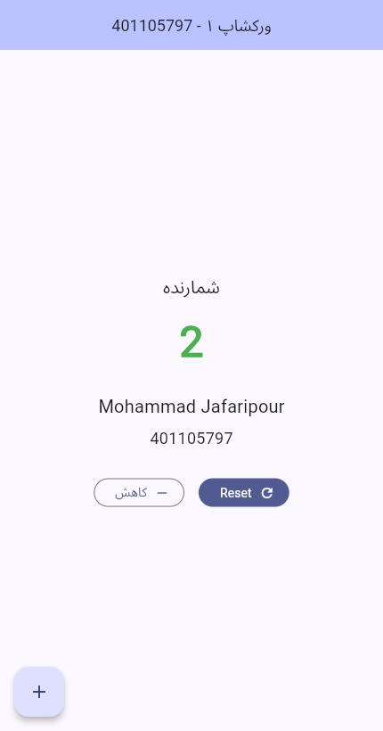

# Workshop 1: Flutter Counter

**Student:** Mohammad Jafaripour

**Student ID:** 401105797

A Flutter counter app for the first Mobile Programming workshop. The app bar displays the workshop title and student ID, and the student's name and ID appear below the counter.

## Features

- Increment the counter with the `+` button.
- Reset the counter to zero with `Reset`.
- Display even values in green and odd values in red.
- Decrement the counter without going below zero. The decrement button is disabled at zero.
- Use a right-to-left layout with Persian interface labels.

## Run

From the `workshop1` directory:

```sh
flutter pub get
flutter run -d chrome
```

For a connected Android device or a running emulator, use `flutter run` and select the target device when prompted.

## Validation

```sh
flutter analyze
flutter test
```

The app was also run in a browser to check incrementing, decrementing, the zero lower bound, and Reset.

## Screenshot

The screenshot shows the counter at an even value of 2.


